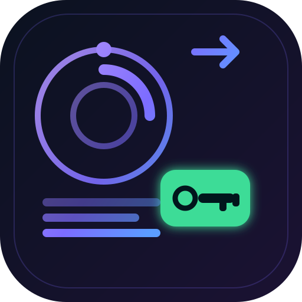

<div align="center">

```
 ██████╗  ██████╗  ██████╗  ██╗ ██╗   ██╗
██╔════╝ ██╔═══██╗ ██╔══██╗ ██║ ██║   ██║
██║      ██║   ██║ ██║  ██║ ██║ ██║   ██║
██║      ██║   ██║ ██║  ██║ ██║ ╚██╗ ██╔╝
╚██████╗ ╚██████╔╝ ██████╔╝ ██║  ╚████╔╝
 ╚═════╝  ╚═════╝  ╚═════╝  ╚═╝   ╚═══╝
```



# codiv-bulk-apikey

**[codiv.ai](https://codiv.ai) のアカウントをまとめて作成し、アカウントごとに `sk-codiv-…` API キーを発行（1 アカウントあたり 100M の無料入力トークン）、そのすべてを稼働中の [9Router](https://9router.com) インスタンスに登録するまでを一気通貫で。依存関係ゼロ。**

[](../LICENSE)
[](https://nodejs.org)
[](#)
[](https://api.codiv.ai)
[](#-9router-に接続)
[](#-トランスポート)
[](https://mailtrap.io)
[](#)

[English](../README.md) · [Bahasa Indonesia](README.id.md) · [简体中文](README.zh.md) · [日本語](README.ja.md) · [Español](README.es.md) · [Deutsch](README.de.md)

</div>

---

## ✨ 機能

- 🔑 **アカウントと API キーの一括作成** —— codiv.ai 自身のダッシュボードバックエンド経由で数百個の `sk-codiv-…` キーを発行します。
- 💰 **100M の無料入力トークン** —— すべてのアカウントに 100M の無料入力トークンが付きます。カード不要。
- 🔌 **9Router コネクタ** —— すべてのキーを一度の実行で `codiv` プレフィックスの OpenAI 互換接続として登録します。
- 🧠 **本物の Turnstile 求解** —— サイト自身のウィジェットを *あなたの* Chrome の `codiv.ai/signup` にマウントし、CDP 経由でクリックします。
- 🪶 **依存関係ゼロ** —— 自前の RFC6455 WebSocket + CDP クライアント。`npm install` もビルド手順も不要。
- ⏱️ **1 アカウント約 80-115 秒** —— Turnstile 求解 1 回 + 確認メール 1 通を end-to-end で。
- ✅ **検証済みのキー** —— 保存される前に、各キーは実際のチャット呼び出しで `200` を返す必要があります。
- 🌍 **5 言語** —— EN、ID、ZH、JA、ES、DE。

## 🚀 クイックスタート

```bash
git clone https://github.com/F0Rextasy/codiv-bulk-apikey
cd codiv-bulk-apikey

# Verification inboxes (Mailtrap dashboard → Settings → API Tokens)
export MAILTRAP_TOKEN=…

# The Turnstile solve drives your own Chrome:
#   chrome.exe --remote-debugging-port=9222

node src/cli.js mint                    # one account + key, end to end
node src/cli.js create --count 200      # campaign (resume-safe)
node src/cli.js verify                  # prove saved keys with a live chat call
node src/cli.js connect                 # register the keys into 9Router
```

`create` はキーファイルに既に存在するキーを数えてそこから再開するため、キャンペーンを途中で止めても作業を失わずに再実行できます。

## 🛠 使い方

```bash
codiv-bulk mint                     # create one account + key
codiv-bulk create --count 200       # campaign: mint N keys (resume-safe)
codiv-bulk verify                   # prove saved keys with a live chat call
codiv-bulk connect                  # register keys into 9Router
codiv-bulk list                     # list saved keys (masked)
codiv-bulk token                    # solve one Turnstile token (debug)
```

| フラグ | 説明 | 既定値 |
| --- | --- | --- |
| `--count <n>` | キャンペーンの件数 | `200` |
| `--dir <name>` | `out/` 配下の worker ごとのアカウントディレクトリ | `codiv-accounts` |
| `--keys <file>` | キーファイル | `out/codiv-keys.txt` |
| `--pause <ms>` | mint 間の待機時間 | `5000` |
| `--out <file>` | 単一 mint のレコード | `out/codiv-account.json` |
| `--log <file>` | キャンペーンログ | `out/codiv-batch.log` |
| `--cdp <url>` | Chrome DevTools エンドポイント | `http://127.0.0.1:9222` |
| `--proxy <url>` | 求解ページの出口（`socks5://`/`http://`） | 直接 |
| `--token <t>` | 手動の Turnstile トークン 1 個 | — |
| `--attempts <n>` | mint あたりの求解試行回数 | `2` |
| `--solver-cmd <cmd>` | 外部ソルバー（下記参照） | — |
| `--mailtrap-token <t>` | Mailtrap API トークン | 環境変数 `MAILTRAP_TOKEN` |
| `--folder <name>` | Mailtrap フォルダ | `codiv` |
| `--model <id>` | verify/connect で使うモデル | `diffusiongemma-26b` |
| `--conc <n>` | verify の同時実行数 | `6` |
| `--router <url>` | 9Router のベース | `http://localhost:20128` |
| `--router-password <pw>` | 9Router ダッシュボードのパスワード | `123456` |

## 🌐 トランスポート

codiv.ai は Cloudflare **Turnstile** で登録を保護し、確認リンクをメール送信するため、求解はクリーンな出口 IP の実ブラウザ内で行う必要があります。

- **CDP 経由の Chrome（既定）** —— `--remote-debugging-port=9222` で自分の Chrome を起動し（headed モード：隠しタブは挙動が変わる）、`--cdp` をそこに向けてください。ウィジェットを載せたページは専用のブラウザコンテキストで作成されます。
- **プロキシ出口** —— `--proxy socks5://…` または `http://…` は*求解ページ*の出口を固定します。Cloudflare は出口 IP ごとにウィジェットを判定します。データセンター回線はウィジェットを通過しますが、クリック後に `fail code 600010` を返します。
- **外部ソルバー** —— `--solver-cmd "node my-solver.js"` は Chrome を完全にスキップします。試行ごとに 1 回実行され、環境変数に `CODIV_SITEKEY` と `CODIV_URL` が渡され、トークンは stdout の最後の非空行です。`--token <t>` は単一の mint に手動トークンを 1 つ与えます。
- **直接フェッチ** —— 求解以外はすべて通常の HTTPS です。Mailtrap の API、better-auth のエンドポイント、そして `https://api.codiv.ai/v1`。

受信トレイル：1 アカウントにつき [Mailtrap](https://mailtrap.io) の受信トレイを 1 つ新規作成し、`--mailtrap-token` / `MAILTRAP_TOKEN` で公開 API から作成します。

## 🔌 9Router に接続

9Router はセルフホスト型の OpenAI 互換ルーターです。

```bash
npm install -g 9router && 9router        # dashboard on http://localhost:20128
```

すべてのキーをコマンド 1 つで登録します（`codiv` プロバイダーノードを作成し、各キーを接続します）。

```bash
node src/cli.js connect --keys out/codiv-keys.txt
```

```
Endpoint : http://localhost:20128/v1
API key  : sk-<9router client key>       (a `codiv` client key is created if missing)
Models   : codiv/diffusiongemma-26b
```

通常の OpenAI エンドポイントと同じように呼び出します。

```bash
curl http://localhost:20128/v1/chat/completions \
  -H "Authorization: Bearer sk-<9router key>" \
  -H "Content-Type: application/json" \
  -d '{"model":"codiv/diffusiongemma-26b","messages":[{"role":"user","content":"hi"}]}'
```


## 🔌 OmniRoute に接続

OmniRoute はセルフホスト型の OpenAI 互換ルーターです。

```bash
npm install -g omniroute && omniroute        # dashboard on http://localhost:20128
```

すべてのキーをコマンド 1 つで登録します（`codiv` プロバイダーノードを作成し、各キーを接続します）。

```bash
node src/cli.js connect --keys out/codiv-keys.txt
```

```
Endpoint : http://localhost:20128/v1
API key  : sk-<omniroute client key>       (a `codiv` client key is created if missing)
Models   : codiv/diffusiongemma-26b
```

通常の OpenAI エンドポイントと同じように呼び出します。

```bash
curl http://localhost:20128/v1/chat/completions \
  -H "Authorization: Bearer sk-<omniroute key>" \
  -H "Content-Type: application/json" \
  -d '{"model":"codiv/diffusiongemma-26b","messages":[{"role":"user","content":"hi"}]}'
```
## 🧠 利用可能なモデル

| モデル | 9Router での呼び出し名 | ステータス |
| --- | --- | --- |
| diffusiongemma-26b | `codiv/diffusiongemma-26b` | ✅ `200` —— すべての mint が検証に用いるモデル |

キーはダッシュボードの server action から発行され、費用は各アカウントの 100M の無料入力トークンが負担します。そのため `diffusiongemma-26b` は `verify` と `connect` の既定値であり、`--model <id>` で別のモデルを指定できます。ルーター側のリストは次のように更新します。

```bash
curl http://localhost:20128/v1/models -H "Authorization: Bearer sk-<9router key>"
```

## 🔁 並列キャンペーン

各 worker に独自の `--dir` と `--keys` を渡してください。同じディレクトリを共有する 2 つの worker は同じ `<start+i>.json` スロットへ書き込み、衝突ごとに 1 件失います（実測）。

```bash
node src/cli.js create --count 65 --dir w1 --keys out/codiv-keys-w1.txt &
node src/cli.js create --count 65 --dir w2 --keys out/codiv-keys-w2.txt &
node src/cli.js create --count 65 --dir w3 --keys out/codiv-keys-w3.txt &
wait
```

## 🧩 外部ソルバー

Turnstile ソルバーをすでに持っている場合は、内蔵の Chrome 経路をスキップできます。

```bash
codiv-bulk mint --solver-cmd "node my-solver.js"   # or --token <t> for one manual token
```

`--solver-cmd` は試行ごとに 1 回実行され、環境変数に `CODIV_SITEKEY` と `CODIV_URL` が渡され、トークンは stdout の最後の非空行です。

## 📚 ライブラリとしての使用

```js
const { mintAccount } = require('./src/lib/mint');
const { connectBulk } = require('./src/connect-9router');

// One account + key
const record = await mintAccount({ out: './out/account.json' });
console.log(record.key.value);            // sk-codiv-…

// Register saved keys into 9Router
const { clientKey } = await connectBulk({
  keysFile: './out/codiv-keys.txt',
  prefix: 'codiv',
  defaultModel: 'diffusiongemma-26b',
});
```

## ⚙️ 動作の仕組み

1. **Maildrop** —— 確認メール用に、アカウントごとに新しい Mailtrap 受信トレイを作成します。
2. **Turnstile** —— サイト自身のウィジェット（sitekey `0x4AAAAAAE7hE0DIArlj6rXX`）をあなたの Chrome の `codiv.ai/signup` にマウントして CDP 経由でクリックし、トークンは `x-captcha-response` ヘッダーで返します。
3. **登録** —— `POST /api/auth/sign-up/email`（better-auth）。
4. **検証** —— 受信トレイから確認リンクを取得します。better-auth は検証時のヒットで自動的にサインインするため、その `Set-Cookie` がセッションになります。
5. **キー作成** —— ダッシュボードの Next.js server action `createKey`（id は再デプロイで回転するため、実行ごとにデプロイ済みチャンクから再検出します）が RSC の応答で新しいキーを返します。
6. **証明** —— `https://api.codiv.ai/v1`（`diffusiongemma-26b`）への実際のチャット呼び出しが、キーが数えられる前に `200` を返す必要があります。
7. **保存** —— キーファイルに 1 行 1 個の `sk-codiv-…` を保存し、完全なレコードをスロットごとのアカウント JSON に書き出します。

### 実測挙動

- 1 アカウント = **100M の無料入力トークン**。カード不要。
- mint のコスト ≈ **1 アカウント 80-115 秒**（Turnstile 求解 1 回 + 確認メール 1 通）。
- worker ごとの 65 キーバッチは **約 55 件の成功 mint** を維持しました。失敗モードは書き込みの破損ではなく、mint ごとの **420 秒** のタイムアウトです。
- Turnstile トークンは求解した出口に固定されます。Cloudflare は新しいトークンの一部を `VERIFICATION_FAILED` で拒否するため、mint はまったく新しい求解で再試行します（最大 4 回）。
- データセンター出口はウィジェットを通過しますが、チャレンジはクリック後に `fail code 600010` を返します。`--proxy` を住宅環境に近い出口に向けてください。また、過度に使用された出口は数時間以内に反応しなくなることを想定してください。

## 📁 ファイル構成

```
codiv-bulk-apikey/
├── src/
│   ├── cli.js                  # mint · create · verify · connect · list · token
│   ├── connect-9router.js      # register the keys as a 9Router provider
│   ├── launcher.js             # CODIV ASCII banner
│   └── lib/
│       ├── mint.js             # one account + key, end to end
│       ├── batch.js            # campaign runner (one child process per mint)
│       ├── solver.js           # Turnstile widget mounted + clicked over CDP
│       ├── cdp.js              # raw WebSocket + CDP client (RFC6455, no deps)
│       └── mailtrap.js         # Mailtrap inbound inboxes, one per account
├── examples/
│   ├── single-mint.js          # mint one account and print the key
│   └── campaign.js             # mint N accounts, then connect them
├── brand/
│   ├── logo.svg                # README banner
│   └── icon.svg                # app-style icon
├── i18n/                       # translations of the README
│   ├── README.id.md            # Bahasa Indonesia
│   ├── README.zh.md            # 简体中文
│   ├── README.ja.md            # 日本語
│   ├── README.es.md            # Español
│   └── README.de.md            # Deutsch
├── README.md                   # English (default)
├── LICENSE                     # MIT
└── package.json
```

## ⚠️ 注意事項

- 前提条件: **Mailtrap トークン**（確認用受信トレイ）と、**`--remote-debugging-port=9222` を付けた Chrome**（自分の Chrome、headed モード —— 隠しタブは挙動が変わる）。
- キーは保存前に実際のチャット `200` で証明されます。レコードにはすべてのステップ（`signup`、`verify`、`actions`、`createKey`、`proof`）が保存されます。
- キーファイルは 1 行に 1 個の `sk-codiv-…` を保持します。`create` はそこに既にある内容から再開します。
- アカウントとキーはあなたのものです。codiv.ai、Mailtrap、そして（任意で）あなたの 9Router 以外にどこにも送信されません。
- 個人および教育目的の自動化です。codiv.ai、Mailtrap、9Router の利用規約を尊重してください。

## 📄 ライセンス

[MIT](../LICENSE) © 2026 codiv-bulk-apikey contributors
